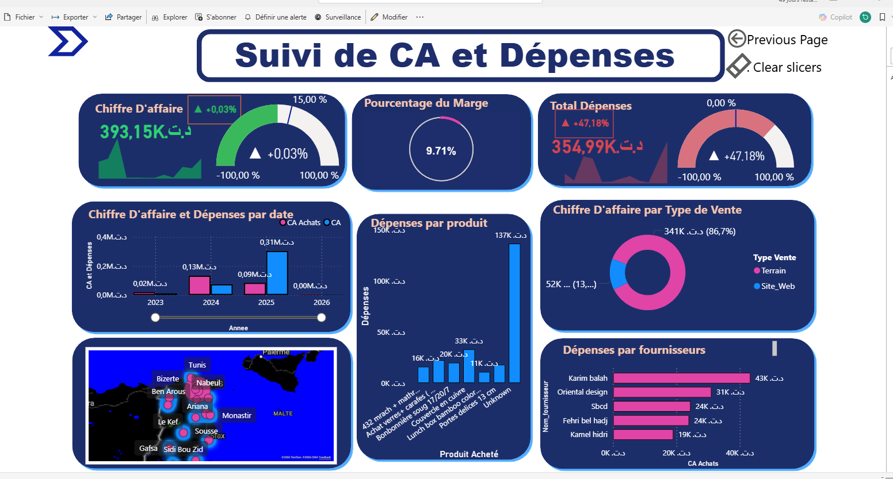

# 🛒 Sougui E-Shop — Business Intelligence & AI Solution

> **Bringing timeless craftsmanship to modern customers worldwide.**  
> A full-stack BI/AI project built for [Sougui](https://sougui.tn), a Tunisian handcraft e-commerce start-up.

---

## 📌 Table of Contents

- [Project Overview](#-project-overview)
- [Problem Statement](#-problem-statement)
- [Business Objectives](#-business-objectives)
- [Architecture](#-architecture)
- [Data Warehouse Model](#-data-warehouse-model)
- [Tech Stack](#-tech-stack)
- [Dashboard Preview](#-dashboard-preview)
- [Data Quality & Cleaning](#-data-quality--cleaning)
- [SDG Alignment](#-sdg-alignment)
- [Project Structure](#-project-structure)
- [Contributors](#-contributors)

---

## 🧩 Project Overview

**Sougui** is a Tunisian start-up that reimagines traditional craftsmanship through modern, refined creations — tableware, interior décor, and artisan pieces blending ancestral traditions with contemporary design.

This project implements a complete **Business Intelligence & AI solution** to transform Sougui's fragmented, manual data management into a centralized, automated, and insight-driven system.

**Key deliverables:**
- Centralized **Data Warehouse** (constellation schema)
- Automated **ETL pipelines** via Talend
- Interactive **Power BI dashboards**
- **ML predictive models** for sales forecasting and customer segmentation

---

## ❗ Problem Statement

| Issue | Impact |
|---|---|
| Fragmented data sources (Excel, PDFs, popup stores) | No single source of truth |
| Manual reporting processes | Time-consuming, error-prone |
| No global performance vision | Reactive rather than proactive decisions |
| Scanned invoices (PDF/images) | Cannot be integrated into analytical systems |
| Inconsistent city names & postal codes | Unreliable geographic analysis |
| Missing SKU references | Difficult product tracking |

---

## 🎯 Business Objectives

The project is structured around 5 strategic pillars to **optimize commercial performance**:

```
Optimize Commercial Performance
├── Strengthen Competitive Advantage
│   └── Improve brand perception vs. competitors
│       ├── Compare products / prices / promotions
│       ├── Communication channel analysis
│       ├── Order cancellation rate
│       └── Return rate
│
├── Increase Revenue
│   ├── Analyze sales (by product, geography, category)
│   ├── Highlight best-performing products
│   └── Identify most important clients (B2B / B2C)
│
├── Minimize Expenses
│   ├── Evaluate suppliers regularly
│   └── Reduce fixed costs and overhead
│
├── Anticipate Business Trends
│   ├── Forecast demand by product and period
│   ├── Predict customer segmentation for targeted offers
│   └── Predict average basket value and purchase frequency
│
└── Promote Innovation & Digital Infrastructure
    ├── Implement advanced tracking for sales & logistics
    ├── Develop predictive ML models
    └── Automate ETL and interactive dashboards
```

---

## 🏗️ Architecture

The BI pipeline follows a classic **5-layer architecture**:

```
Data Sources          Staging Area       Data Warehouse       Power BI          ML Models
─────────────         ────────────       ──────────────       ────────          ─────────
• Excel files   ──►   • Data             • Fact tables  ──►   • KPI             • Sales
• PDF invoices  Extr.   centralization   • Dim. tables  Conn.   dashboards        forecasting
• Competitor    ──►   • Initial     ETL  • Constellation ──►  • Interactive ──► • Trend
  websites              cleaning  Talend  schema               analysis          analysis
• Social media                                                 • Global viz.   Feeding/
• Web scraping                                                                  Scoring
```

**Tools per layer:**

| Layer | Tool |
|---|---|
| Data Sources | Excel, PDF, JPG/screenshots, Word |
| Data Quality & EDA | Python |
| ETL | Talend |
| Storage | Microsoft SQL Server |
| Visualisation | Power BI |
| Frontend | Angular |
| Backend | Flask (Python) |
| Orchestration | Apache Airflow |
| Automation | n8n |

---

## 🗃️ Data Warehouse Model

The DW uses a **constellation schema** (multiple fact tables sharing dimension tables):

### Fact Tables

**`Fact_Ventes`** — Sales transactions
- `Vente_PK`, `Date_FK`, `Type_Vente_FK`, `Produit_FK`, `Categorie_FK`, `Client_FK`, `Geographie_FK`, `Mode_Paiement_FK`
- Measures: `Quantite`, `Montant_Livraison`, `Montant_Remboursement`, `Montant_de_la_commande`, `Montant_Remise`

**`Fact_Achats`** — Purchase / supply transactions
- `Achat_PK`, `Date_FK`, `Fournisseur_FK`, `Type_Paiement_FK`, `Produit_FK`
- Measures: `Prix`, `Parano?`, `Prix_Promo`

### Dimension Tables

| Table | Key Fields |
|---|---|
| `Dim_Date` | Date, Jour_Mois_Annee, Annee, Semestre, Trimestre, Mois, Lib_Mois |
| `Dim_Produit` | Produit_PK, UGS, Nom_produit, Description, Url, Visibilite, Prix, Prix_en_promo |
| `Dim_Client` | Client_PK, Code_client, Nom_client, Prenom_client, Ville, Type_client |
| `Dim_Categorie` | Categorie_PK, Categorie, source |
| `Dim_Geographie` | Geographie_PK, Ville, Code_postal, Pays, Code_pays |
| `Dim_Fournisseur` | Fournisseur_PK, Matricule_fiscale, Nom_fournisseur |
| `Dim_Mode_Paiement` | Mode_Paiement_PK, Type_paiement |
| `Dim_Type_Vente` | Type_Vente_PK, Type_Vente |

---

## 🛠️ Tech Stack

```
Python          — EDA, data cleaning, OCR (PDF extraction), ML models, web scraping
Talend          — ETL pipelines
SQL Server      — Data Warehouse storage
Power BI        — Dashboards & DAX measures
Angular         — Frontend application
Flask           — Backend API
Apache Airflow  — Pipeline orchestration
n8n             — Workflow automation
```

---


---

## 📊 Dashboard Preview

The Power BI dashboard **"Sougui Dashboard des Ventes"** features:

- **KPI Cards** — YTD Ventes, YTD Profit, Variation CA (+8.21%), Panier Moyen (128 DT)
- **Top 5 / Bottom 5 Produits par Ventes** — Horizontal bar charts
- **YTD Ventes Par Région** — Donut chart (Tunis, Ariana, Nabeul, Bizerte, QR code)
- **YTD Ventes Par Catégorie** — Donut chart by product category
- **CA par Mois** — Monthly revenue bar chart
- **Refund/Delivery detail table** — UGS, customer, quantity, reimbursement

Filters available: **Date**, **Client**, **Produit**, **Fournisseur**




---

## 🧹 Data Quality & Cleaning

### Issues Identified & Solutions

| Issue | Observation | Cleaning Strategy |
|---|---|---|
| **Missing SKU references** | Some products have no SKU | Deduce from official website OR generate from product name |
| **Inconsistent postal codes** | Same city, different codes | Create valid postal code reference list, standardize |
| **Non-standardized city names** | Multiple spellings per city | Levenshtein distance matching against valid city list |
| **Manual popup store entries** | Typos and inconsistencies in product names | Fuzzy matching + ETL normalization |
| **Scanned invoices** | PDF/image invoices not machine-readable | OCR extraction → structured digital records |

### External Data Sources (Competitive Intelligence)

Competitor product & price data collected via web scraping from:
- **Sougui** — own product catalog
- **Kalys** — competitor products & prices
- **Edayetna** — competitor products & prices

---

## 🌍 SDG Alignment

This project contributes to 3 United Nations Sustainable Development Goals:

| SDG | Goal | How |
|---|---|---|
| **SDG 8** | Decent Work & Economic Growth | Supports local artisans through data-driven performance improvement |
| **SDG 9** | Industry, Innovation & Infrastructure | Modernizes traditional commerce with BI & AI technologies |
| **SDG 12** | Responsible Consumption & Production | Reduces waste through optimized inventory management |

---

## 📁 Project Structure

```
sougui-bi/
│
├── data/
│   ├── raw/                    # Original Excel files, scanned PDFs
│   ├── staging/                # Cleaned staging area data
│   └── external/               # Scraped competitor data
│
├── etl/
│   ├── talend_jobs/            # Talend ETL job exports
│   └── python/
│       ├── ocr_extraction.py   # PDF/image OCR pipeline
│       ├── web_scraping.py     # Competitor price scraper
│       └── data_cleaning.py    # City names, postal codes, SKU fixes
│
├── sql/
│   ├── create_dw.sql           # Data Warehouse schema
│   └── staging_scripts/        # Staging area SQL scripts
│
├── powerbi/
│   └── sougui_dashboard.pbix   # Power BI dashboard file
│
├── ml/
│   ├── sales_forecasting.py    # Demand forecasting model
│   ├── customer_segmentation.py # RFM / clustering model
│   └── basket_prediction.py    # Average basket value model
│
├── backend/                    # Flask API
├── frontend/                   # Angular app
├── airflow/                    # DAG definitions
└── README.md
```

---


## 👥 Contributors

| Role | Name |
|---|---|
| CEO / Business Stakeholder | Hamza Jabnouni |
| Operations & Technical Lead | Alaeddine Abidi |
| BI / Data Team | Project Team |

---

## 📜 License

This project was developed as part of an academic Business Intelligence project at ESPRIT School of Engineering (ESPRIT) for **Sougui E-Shop**. All business data used in this project is proprietary.

---

